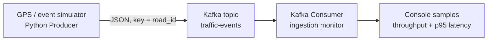

# Quy trình 1: Sources → Ingestion

## Mục tiêu

Mô phỏng nguồn GPS phương tiện và thu thập sự kiện giao thông liên tục vào Apache Kafka. Demo thể hiện producer, topic, partition, throughput và độ trễ từ lúc tạo sự kiện đến lúc consumer nhận được.

> Dữ liệu GPS trong bản demo được sinh tổng hợp, không phải dữ liệu giao thông thực. Bộ sinh chủ động tạo các khoảng tốc độ thấp để nhóm có thể mở rộng thành bài toán phát hiện ùn tắc ở giai đoạn sau.

## Kiến trúc



Kafka dùng chế độ KRaft một node cho demo cục bộ. Topic được tạo tường minh với ba partition; broker tắt auto-create để tránh topic sai schema/cấu hình. Producer dùng `acks=all`, retry và gzip; bộ đếm gửi chỉ tăng xác nhận sau khi broker ACK. Consumer tham gia consumer group trước khi producer chạy để không bỏ lỡ sự kiện đầu.

## Schema sự kiện

Mỗi message có envelope chung gồm `event_id`, `event_time` (UTC ISO-8601), `event_type`, `source`, `road_id`, `district`, `latitude`, `longitude`, `sequence` và `payload`. Payload thay đổi theo loại sự kiện: `gps_position` mang mã xe/tốc độ/sức chứa; `road_sensor` mang mã cảm biến/tốc độ trung bình/lưu lượng/mưa; `traffic_incident` mang mã sự cố/loại/mức độ/người báo. Mô hình envelope + payload minh họa nhiều nguồn và schema bán cấu trúc trong cùng topic. Message key là `road_id`, giúp các sự kiện cùng tuyến được định tuyến ổn định vào cùng partition.

## Yêu cầu

- Windows/macOS/Linux có Docker Desktop hoặc Docker Engine và Docker Compose.
- Python 3.10 trở lên để chạy producer và consumer trên máy chủ.
- Internet ở lần đầu để Docker tải image Kafka và pip tải thư viện `kafka-python`.

## Chạy demo trên Windows PowerShell

Mở terminal tại thư mục `QuyTrinh1-Sources-Ingestion`.

```powershell
docker compose up -d
docker compose ps
```

Tạo môi trường Python và cài thư viện:

```powershell
py -3 -m venv .venv
.\.venv\Scripts\Activate.ps1
python -m pip install -r requirements.txt
```

Nếu `py -3` báo chưa tìm thấy Python trong khi máy đã cài Python, thay lệnh đầu bằng đường dẫn đến `python.exe` đã cài, ví dụ trên máy phát triển này:

```powershell
& "$env:LOCALAPPDATA\Programs\Python\Python314\python.exe" -m venv .venv
```

Mở cửa sổ thứ nhất để chạy consumer trước:

```powershell
python src/consumer.py
```

Mở cửa sổ thứ hai để phát 2.000 sự kiện ở tốc độ mục tiêu 50 sự kiện/giây:

```powershell
python src/producer.py --count 2000 --rate 50 --seed 42
```

Consumer in message mẫu và số liệu định kỳ: tổng sự kiện, tốc độ nhận trong cửa sổ 5 giây và p95 độ trễ event-to-consume. Nhấn `Ctrl+C` để dừng consumer. Có thể tăng tải bằng `--rate 200`, hoặc dùng `--rate 0 --count 10000` để phát nhanh nhất có thể.

### Chạy demo tự động và lưu minh chứng

Sau khi Kafka chạy và cài thư viện, chạy một lệnh:

```powershell
python src/run_demo.py --rates 100,500,1000 --count 5000
```

Runner tạo topic nếu chưa có, xác nhận consumer đã join đủ partition rồi mới phát dữ liệu, chạy ba mức tải, đối chiếu ACK của broker với message consumer nhận, kiểm tra event_id/sequence không trùng hoặc mất và xác nhận đủ ba event_type ở lượt từ 100 event trở lên. Log được lưu tại `logs/ingestion-<timestamp>.log`. Lượt chạy chỉ kết thúc bằng `RESULT PASS` khi các kiểm tra toàn vẹn đều đạt. Có thể điều chỉnh `--count` hoặc `--rates` để thử nghiệm.

## Kiểm tra Kafka trực tiếp

```powershell
docker exec bigdata-ingestion-kafka /opt/kafka/bin/kafka-topics.sh --bootstrap-server localhost:9092 --describe --topic traffic-events
docker exec bigdata-ingestion-kafka /opt/kafka/bin/kafka-consumer-groups.sh --bootstrap-server localhost:9092 --describe --group traffic-ingestion-demo
```

Lệnh đầu cho thấy số partition và leader; lệnh sau cho thấy offset của consumer group.

## Cách đọc số đo

- `window_rate`: message consumer xử lý mỗi giây trong cửa sổ báo cáo gần nhất.
- `event_to_consume_p95`: phân vị 95 của thời gian từ `event_time` ở producer đến lúc consumer nhận message. Dòng `SUMMARY` tính trên cả lượt với tối đa 10.000 mẫu gần nhất; dòng `METRICS` tính trên cửa sổ 5 giây gần nhất. Đây là độ trễ end-to-end của demo, không phải Kafka broker latency riêng.
- So sánh nhiều lượt với `--rate 100`, `--rate 500`, `--rate 1000`; ghi lại tốc độ phát, tốc độ nhận và p95. Báo cáo cấu hình máy và dùng nhiều lượt để kết quả có ý nghĩa.
- `ack_rate` ở producer được tính từ các message broker đã xác nhận, không phải số message mới đưa vào bộ đệm cục bộ.

## Đặc trưng Big Data trong phạm vi này

- **Volume:** benchmark nạp tổng cộng 15.000 sự kiện, theo từng đợt 5.000 để đo tải kéo dài hơn demo ngắn.
- **Velocity:** nguồn phát liên tục theo tốc độ đặt; thử ở 100, 500 và 1.000 sự kiện/giây.
- **Variety:** ba nguồn mô phỏng phát GPS xe, cảm biến vòng từ và sự cố trung tâm điều phối với payload riêng trong JSON bán cấu trúc.

Đây là môi trường demo một broker, không phải triển khai production hay benchmark cụm phân tán. Báo cáo cần nêu giới hạn này và không khẳng định một máy đơn đã chứng minh khả năng scale của cluster nhiều node.

## Minh chứng nên thu thập

1. Chụp `docker compose ps` khi Kafka đang chạy.
2. Chụp consumer hiển thị event mẫu và ít nhất ba dòng `METRICS`.
3. Giữ log tự sinh trong `logs/`; log có rate mục tiêu, số gửi/ACK/nhận, throughput nhận, p95 latency và thời điểm chạy.
4. Chụp kết quả `kafka-topics.sh --describe` để chứng minh topic/partition.
5. Ghi đóng góp từng thành viên và lệnh tái lập demo.

### Lượt chạy kiểm tra trên máy phát triển

Với broker một node, mỗi mức tải gửi 5.000 sự kiện. Consumer nhận đủ số message đã xác nhận bởi broker ở cả ba mức. Bằng chứng đầy đủ nằm tại [`logs/ingestion-20261031-051334.log`](logs/ingestion-20261031-051334.log).

| Mục tiêu producer | Broker ACK | Consumer nhận | Consumer throughput trung bình | p50 end-to-end | p95 end-to-end |
|---:|---:|---:|---:|---:|---:|
| 100 sự kiện/giây | 5.000/5.000 | 5.000/5.000 | 99,3 sự kiện/giây | 11,2 ms | 18,1 ms |
| 500 sự kiện/giây | 5.000/5.000 | 5.000/5.000 | 482,0 sự kiện/giây | 10,1 ms | 19,9 ms |
| 1.000 sự kiện/giây | 5.000/5.000 | 5.000/5.000 | 932,1 sự kiện/giây | 11,9 ms | 20,7 ms |

Tổng cộng 15.000 sự kiện được producer gửi và broker xác nhận, consumer đọc đủ. Ở cả ba lượt, event_id duy nhất, sequence không trùng/khuyết và cả ba event_type đều có mặt. Summary ghi phân bố event_type. Đây là phép đo trên một máy với một broker và factor replica 1; kết quả kiểm chứng tốc độ/tính liên tục của pipeline demo, không phải benchmark tải tối đa, kiểm thử HA hay cam kết hiệu năng cho máy khác. Log đầy đủ: [`logs/ingestion-20261031-051334.log`](logs/ingestion-20261031-051334.log).

## Dừng demo

```powershell
docker compose down
```

Muốn xóa cả dữ liệu Kafka lưu trong Docker volume:

```powershell
docker compose down -v
```

Lệnh `-v` xóa dữ liệu demo trong volume của dự án.

## Cấu trúc thư mục

```text
QuyTrinh1-Sources-Ingestion/
├── docker-compose.yml
├── requirements.txt
├── README.md
└── src/
    ├── producer.py
    ├── consumer.py
    └── run_demo.py
```

## Hướng phát triển

- Thay simulator bằng API hoặc dữ liệu GPS có nguồn và giấy phép sử dụng rõ ràng.
- Thêm schema validation, dead-letter topic và thử nghiệm mất kết nối broker.
- Mở rộng consumer thành Spark Structured Streaming ở quy trình xử lý kế tiếp.
